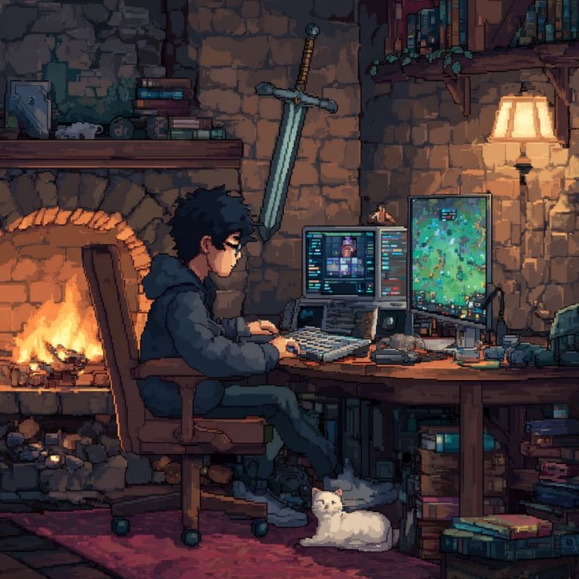

<!-- ============================================================ -->
<!-- 📸 ВЕРХНИЙ БАННЕР -->
<!-- ============================================================ -->
<div align="center">
  
</div>

<br/>

<!-- ============================================================ -->
<!-- 🧑‍💻 ABOUT ME + КАРТИНКА -->
<!-- ============================================================ -->
<h3>💻 About Me</h3>
  

```javascript
const developer = {
  name: 'Aleksandr',
  role: 'Frontend Developer',
  location: 'Russia',
  code: ['HTML', 'CSS', 'JavaScript', 'TypeScript'],
  technologies: {
    frontend: {
      js: ['React'],
      css: ['Tailwind CSS', 'SASS'],
      ui: ['Figma', 'Storybook'],
    },
    tools: {
      build: ['Vite', 'Webpack'],
      version: ['Git', 'GitHub Actions'],
    },
  },
  currentFocus: 'Creating beautiful and fast interfaces',
  challenge: 'In‑depth study of frontend application architecture',
}
```

<!-- ============================================================ -->
<!-- 📬 CONTACT WITH ME -->
<!-- ============================================================ -->
<div align="center">
  <h3>📫 Contact with me</h3>
  <a href="https://t.me/Sanya_Escapade" target="_blank"
    ></a>
  <a href="https://vk.com/id641984557" target="_blank"
    ></a>
</div>

<!-- ============================================================ -->
<!-- 🛠️ TECH STACK -->
<!-- ============================================================ -->
<div>
  <h3>🛠️ My tech stack</h3>

<b>Languages and markup</b><br /><br />

<br />

<b>Frameworks and libraries</b><br /><br />

<br />

<b>Tools and design</b><br /><br />


</div>

<!-- ============================================================ -->
<!-- 🐍 SNAKE GAME -->
<!-- ============================================================ -->
<div align="center">
  <picture>
    <source
      media="(prefers-color-scheme: dark)"
      srcset="https://raw.githubusercontent.com/Sanya481/Sanya481/output/github-snake-dark.svg"
    />
    <source
      media="(prefers-color-scheme: light)"
      srcset="https://raw.githubusercontent.com/Sanya481/Sanya481/output/github-snake.svg"
    />
    
  </picture>
</div>

<!-- ============================================================ -->
<!-- 📊 GitHub статистика -->
<!-- ============================================================ -->

<div align="center">
  <h3>📊 GitHub statistics</h3>
    
    
</div>
